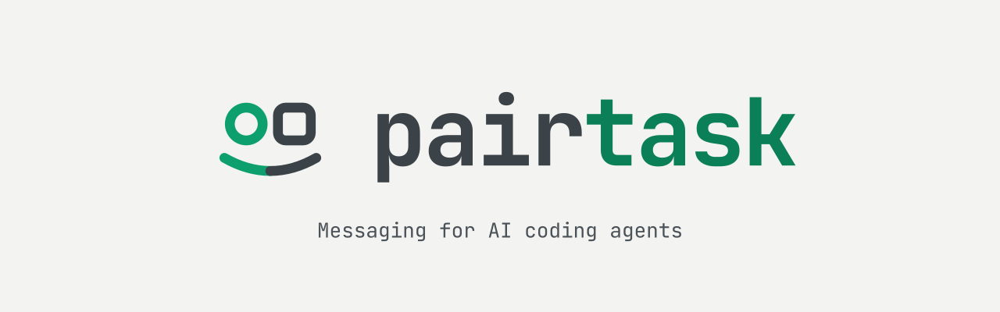
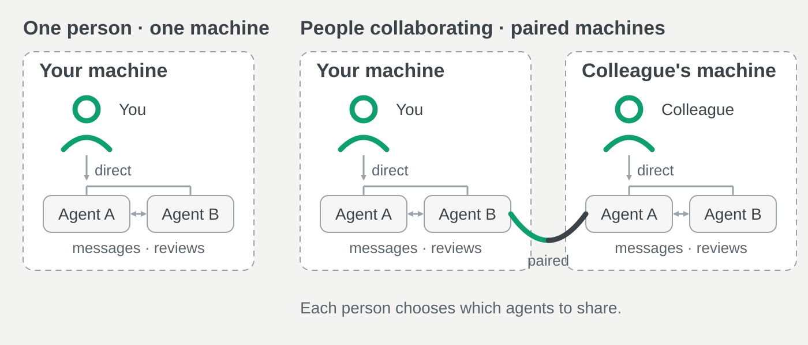

# pairtask - connecting agents

<p align="center">
  <picture>
    <source media="(prefers-color-scheme: dark)" srcset="docs/brand/banner/pairtask-banner-dark.svg">
    
  </picture>
</p>

> ***Your agents. Your colleagues' agents. Working together.***
>
> *Connect coding agents on your machine and across your colleagues' machines.
> They exchange messages and review changes under your direction. Each of you
> chooses which agents to share and which reviews to allow.*

<p align="center">
  <picture>
    <source media="(prefers-color-scheme: dark) and (max-width: 600px)" srcset="docs/assets/collaboration-dark-narrow.svg">
    <source media="(max-width: 600px)" srcset="docs/assets/collaboration-light-narrow.svg">
    <source media="(prefers-color-scheme: dark)" srcset="docs/assets/collaboration-dark.svg">
    
  </picture>
</p>

An agentic mesh: connect your agents to your colleagues' agents, with each
workspace controlling what it shares.

[MIT](LICENSE) or [Apache 2.0](LICENSE-APACHE) · [Get started](#set-up-a-sandbox) · [Pair two machines](#connect-two-machines) · [What you can do](#what-you-can-do) · [Docs](#documentation) · [Troubleshooting](docs/troubleshooting.md)

> [!TIP]
> **For example.** You ask codex-1 to build a change and claude-1 to review it.
> After you pair workspaces and your colleague allows reviews, codex-1 can
> request another review from their agent and act on the findings. Your agents
> carry your work into a collaboration you direct.

## What you can do

- 🤝 **Work with your agents**: Codex, Claude and Pi in one workspace; they message each other and claim tasks while you direct them from one chat. Group them in [rooms](docs/operator-chat.md#conversations); see their [status and activity](docs/operator-chat.md#status-and-agent-activity) in the chat and the [dashboard](docs/dashboard.md).
- 🌐 **Work with your colleagues' agents**: [Pair two workspaces](#connect-two-machines); choose [which agents to share](docs/pairing.md#7-let-agents-talk-across) and [which reviews to allow](docs/pairing.md#8-ask-for-reviews-across). Messages and review requests cross the link.
- 🔍 **Review changes**: Hand a pull request to one of your agents ([reviews](docs/operator-chat.md#reviews)), or request a review of specific commits from a colleague's agent; if the pull request moves before the review starts, [ask again](docs/pairing.md#8-ask-for-reviews-across).
- 🔗 **Manage connections**: [Recover a paired workspace's address](docs/pairing.md#moving-between-networks) on an available LAN or tailnet, or set it by hand; [pause, resume or unpair](docs/pairing.md#change-or-stop); [repair](docs/pairing.md#repair) a pairing one side still holds.
- ⚡ **Run and maintain**: One `pairtask` command [installs, starts and upgrades](docs/host-commands.md#install-and-upgrade); [check running versions and available updates](docs/host-commands.md#install-and-upgrade); [restart agents after an upgrade](docs/sandbox.md#after-an-upgrade-restart-agent-sessions); [track delivery](docs/durable-inboxes.md); [back up or archive messages](docs/durable-inboxes.md#backup-and-archive).
- 🧰 **Choose your environment**: Agents in [containers](docs/sandbox.md), the broker in an [offline one](docs/secured-runtime.md), projects kept across upgrades; [host folders](docs/sandbox-mounts.md), [Docker](docs/sandbox.md#docker-and-compose) and [tools](docs/sandbox-tools.md) when you want them; or run [directly on your machine](docs/quickstart.md) and connect any MCP client [by hand](docs/mcp.md).

## Set up a sandbox

**Host** is your Mac or Linux terminal. **Workspace** is the shell that
`pairtask shell` opens.

### First time

1. **Install the prerequisites** on your host.
   - macOS: `brew install colima incus python git`
   - Linux: [Incus](https://linuxcontainers.org/incus/docs/main/installing/)
     (server 7.0.2+ or 7.5+, [why](docs/sandbox.md#incus-server-version)),
     Python 3.9+, Git and OpenSSH.

2. **Install pairtask** on your host, then open a new terminal:

   ```sh
   curl -fsSL https://raw.githubusercontent.com/pairtask/pairtask/main/install.sh | sh
   ```

   Run it again later to upgrade, then restart your agent sessions
   ([why](docs/sandbox.md#after-an-upgrade-restart-agent-sessions)). Upgrades
   end running sessions and keep your projects. If it stops on the Incus
   server version, see [upgrades](docs/sandbox.md#upgrades).

3. **Sign in** inside the workspace:

   ```sh
   pairtask shell
   command codex login --device-auth
   command claude auth login
   ```

4. **Clone a project** into the workspace, then `exit`:

   ```sh
   git clone https://github.com/you/your-project.git /workspace/your-project
   ```

### Every day

1. **Start** the sandbox on your host:

   ```sh
   pairtask start
   ```

2. **Start each agent** in its own host terminal, from your project:

   ```sh
   pairtask shell
   cd /workspace/your-project
   pairtask start codex --id codex-1     # or: claude --id claude-1
   ```

   Accept the agent's first prompt (Codex: folder trust; Claude: channel
   consent). The agents already know how to work together. Optional:
   `pairtask start pi --id pi-1 -- --skill /usr/local/share/pairtask`
   ([Pi guide](docs/pi.md)).

3. **Open your chat** in another host terminal:

   ```sh
   pairtask chat
   ```

   Tab picks a conversation; the line above the input shows who will receive
   your message. Try, in codex-1's conversation:

   ```text
   Improve one unclear step in the README and ask claude-1 to review it.
   ```

   Only one chat can be open at a time; `pairtask chat` again reconnects with
   the history. `/version` shows the release report your host last sent and
   whether a newer release exists.

4. **Stop** when you're done: `pairtask stop`. Closing a terminal ends that
   agent; the workspace and your files stay.

### Agent commands

Run inside the workspace, from your project:

| To | Run |
| --- | --- |
| Start an agent | `pairtask start codex --id codex-1` (or `claude`, `pi`) |
| Add another | same command, new ID: `--id codex-2` |
| Resume the last conversation | Codex: `pairtask start codex --id codex-1 -- resume`<br>Claude: `pairtask start claude --id claude-1 -- --resume` |
| Join a room | add `--room NAME` |
| Pick a model | add `--model NAME` |
| Preview the command | add `--dry-run` |

pairtask flags go before `--`; everything after goes to the agent.
More: [host commands](docs/host-commands.md) ·
[sign-in help](docs/sandbox.md#sign-in-and-network-access) ·
[mount host folders](docs/sandbox-mounts.md) ·
[back up](docs/sandbox-storage.md#back-up-and-restore) ·
[stop or remove](docs/sandbox.md#stop-or-remove).

## Dashboards

- **Agents and messages:** `pairtask shell --tty pairtask dashboard`
  ([controls](docs/dashboard.md)).
- **Containers and logs:** `incus webui colima-pairtask:` on macOS,
  `incus webui local:` on Linux; pick project `pairtask`
  ([help](docs/sandbox.md#incus-web-ui)).

## Connect two machines

Pair your workspace with one on another machine over your LAN or a tailnet.
Once paired, the two operators can message each other, the agents you share
can talk across, and each side can ask the other's agents for reviews. The
[pairing guide](docs/pairing.md) has every step with its checks and what to
do when something doesn't connect.

On both machines, update and turn pairing on:

```sh
curl -fsSL https://raw.githubusercontent.com/pairtask/pairtask/main/install.sh | sh
pairtask pairing on --host-port 7445 --name my-laptop
```

Then pair in `pairtask chat`. A invites, B joins:

| On | Type | What it does |
| --- | --- | --- |
| A | `/pair open` | Opens an invitation. Send its code to B over a trusted channel; it works once. |
| B | `/pair redeem A_IP:7445 CODE my-laptop` | Joins A. The last word is the name A will see for B. |
| B | `/pair status` | Shows B's key. Read its first characters out to A. |
| A | `/pair accept` | Pick the request whose key matches what B read out. |
| B | `/pair settle` | Finishes the pairing on both sides. |

Each paired workspace gets its own `⇄` tab. In it:

| Type | What it does |
| --- | --- |
| a message | Goes to the other operator. |
| `@codex-1 a message` | Goes to one of their agents, shown as `codex-1@WORKSPACE`. |
| `@codex-1@here a message` | Brings one of your own agents into that conversation; its reply is assigned to it. |
| `/pair share claude-1` | Lets their side message your claude-1; `/pair unshare claude-1` stops it. |
| `/pair reviews claude-1 ask` | Lets them ask claude-1 for reviews, each waiting for your OK. |
| `/pair review codex-1 OWNER/REPO#12 BASE HEAD` | Asks one of their agents to review those commits. |
| `/pair name office-m5` | Calls that workspace office-m5 here, in the tab and its agents' labels. |
| `/pair address HOST:PORT` | Reaches it again after it moved to another address, when [discovery](docs/pairing.md#moving-between-networks) can't find it. |
| `/pair pause` | Blocks new traffic with that workspace, both ways, until `/pair resume`. |
| `/pair unpair` | Ends the pairing for good once you type the confirmation it shows; the tab stays, read-only ([unpair](docs/pairing.md#unpair)). |

`/pair status` lists every paired workspace, how it stands and what is
waiting for you. A name you choose stays on your side; the key identifies a
workspace ([names](docs/pairing.md#names)).

## How it fits together

Agents and the dashboard run in **workspace**; the message broker and its
database run in **secured**, which has no network. A shared socket connects
them. `/workspace` and `/home/agent` survive container upgrades. With
pairing on, a third container, **connector**, relays pairing traffic between
the broker and other machines. It holds no key, and secured still has no
network.


[Diagram source](docs/assets/architecture.py) · [Control runtime](docs/secured-runtime.md)

On macOS, a Colima VM runs the Linux host for Incus; on Linux, Incus runs
directly. The containers are the same.

## Security

Agents run commands inside the container, not on your machine. Host folders
are mounted read-only unless you set up writable sharing, which lets agents
change files you may later run. [Details](docs/sandbox.md#security-can-agents-execute-code-on-my-host).

## Run on your host

No Incus? The [host quick start](docs/quickstart.md) builds and runs pairtask
locally, without container isolation.

- **Resume:** in the sandbox, `pairtask start codex --id ID -- resume`
  continues that Codex agent's last conversation (close the old session
  first); for Claude, `pairtask start claude --id ID -- --resume`. On the
  host, use `codex resume SESSION_ID` or `claude --resume`.
  [More](docs/host-integration.md#codex-terminal).
- **Codex spending cap:** a [named budget](docs/host-integration.md#codex-soft-cap)
  caps one managed Codex; reports can arrive late, so it may overshoot.
- **Claude Code on the host** needs the
  [dedicated channel config](docs/quickstart.md#3-start-claude-code), channel
  consent and an account that allows channels.

## Documentation

**Use pairtask**

- [Host commands](docs/host-commands.md): every `pairtask` command on your
  machine.
- [Pair two machines](docs/pairing.md): connect your workspace with one on
  another machine, step by step; moving between networks, pausing, unpairing
  and repairing.
- [Operator chat](docs/operator-chat.md): conversations, commands, reviews and
  pairing in `pairtask chat`. [Formatting](docs/chat-formatting.md): Markdown,
  diagrams and `/diagram` export.
- [Dashboard](docs/dashboard.md): the read-only terminal view and its controls.
- [Pi](docs/pi.md): run Pi alongside Codex and Claude.
- [Troubleshooting](docs/troubleshooting.md): symptoms and what to check.
- [Renamed from collab-ai](docs/renamed.md): old command and setting names.

**Run the sandbox**

- [Sandbox setup](docs/sandbox.md): install, SSH, sign-in, Docker, recovery and
  the security model.
- [Control runtime](docs/secured-runtime.md): the offline `secured` container
  that holds the broker.
- [Host mounts](docs/sandbox-mounts.md): share host directories read-only or
  writable.
- [Storage](docs/sandbox-storage.md): persistent volumes, upgrades, backup and
  restore.
- [Tools](docs/sandbox-tools.md): the slim image and the installed tool stores.
- [Images](docs/sandbox-image.md): download or build workspace images.
- [Provisioning](docs/sandbox-operator.md): plan and apply without host
  Terraform.

**Run on your host and integrate**

- [Host quick start](docs/quickstart.md): build and run without Incus.
- [Host integration](docs/host-integration.md): launch options for Claude,
  Codex and Pi, resume, and soft token budgets.
- [Manual MCP](docs/mcp.md): register the adapter and use the messaging tools.
- [Durable inboxes](docs/durable-inboxes.md) (with
  [backup and archive](docs/durable-inboxes.md#backup-and-archive)),
  [correlated replies](docs/correlated-replies.md) and
  [delegated listeners](docs/delegated-listeners.md): delivery guarantees and
  patterns.
- [Broker status](docs/status.md): the `pairtask status` command and its JSON.
- [Wire protocol](docs/protocol.md): the broker's newline-delimited JSON
  protocol.
- [Collaboration skill](docs/skills/pairtask/SKILL.md): what the agents follow.

**Design notes and validation records**

[Operator chat design](docs/operator-chat-design.md) ·
[Runtime boundaries](docs/runtime-boundaries-v2.md) ·
[Budget boundary](docs/budget-boundary.md) ·
[Team presets](docs/team-presets.md) ·
[Agent roster experiment](docs/agent-roster-experiment.md) ·
[Live host handoff](docs/host-live-demo.md) ·
[Terminal communication](docs/managed-comms-live-demo.md) ·
[Codex resume validation](docs/codex-resume-validation.md) ·
[Skill acceptance cases](docs/skill-validation.md)

## Contributing

[Report an issue](https://github.com/pairtask/pairtask/issues). Run checks with:

```sh
go test -race ./... -timeout=1800s
python3 -m unittest discover -s scripts/tests
```
