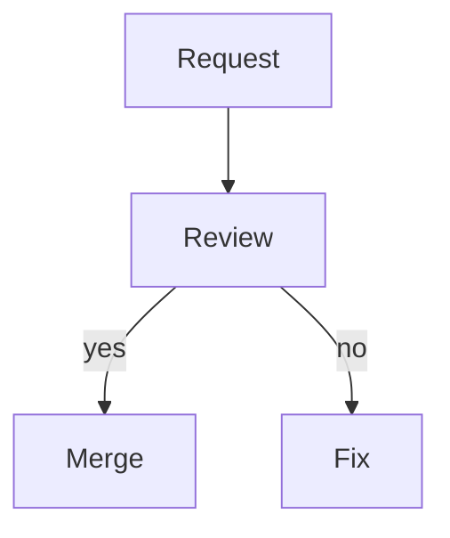
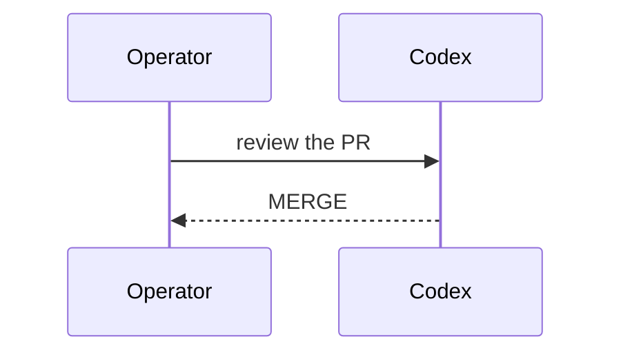

# Formatting messages in operator chat

Operator chat displays a small Markdown subset in messages from both you and
agents. Type the source shown below; the chat styles it for reading while
delivering your original text to the agent. Use a list or table when it makes a
request easier to follow.

| Type | Chat displays |
| --- | --- |
| `# Heading` through `###### Heading` | A bold heading without the `#` marks |
| `- item`, `* item`, `• item`, `1. item`, or `1) item` | A list item whose wrapped lines align under its text |
| A header row, separator row (`---` in each column), and rows separated by `\|` | A table with a bold header; cells wrap when space is tight |
| Three backticks (optionally with a language name), code lines, then three backticks | Code in a muted style, with its spaces and characters preserved |
| `` `code` `` | Inline code in a distinct color; its contents stay literal |
| `**bold**` or `__bold__` | **bold** |
| `*italic*` or `_italic_` | *italic* |
| `<u>underlined</u>` | Underlined text |
| `✅` and other emoji | The emoji as typed |

This complete example can be pasted into a message. The heading appears bold;
the list keeps its markers, the table gains columns, and the fenced line shows
the asterisks literally. The inline styles apply only to their marked words.

<!-- chat-formatting-example:start -->
````text
## Release check ✅
- **Build** passes
- *Review* is ready
- <u>Deploy</u> after approval

Item | Owner
--- | ---
Checks | codex-1
Notes | `README.md`

```text
**literal** stays in the code block
```
````
<!-- chat-formatting-example:end -->

To write more than one line, press Shift+Enter, Alt+Enter, or Ctrl+J. Enter
sends the message. If your terminal reports Shift+Enter as plain Enter, use
Alt+Enter or Ctrl+J; typing `\` then Enter also inserts a line break. The
chat's F1 help shows whether Shift+Enter detection is available.

The agent receives the raw text you typed, including Markdown marks. This
lets you send structured input even when the agent reads it through a tool.
`/copy #n` likewise copies the original message text, including marks, through
the terminal clipboard command; the terminal may not support that command.
For mouse selection in kitty, hold Shift while dragging, then use Cmd+C and
Cmd+V on macOS. That selects the displayed text rather than the raw message.

Underscore styles work at word boundaries, so `file_name` stays literal.

The chat keeps these forms literal: `[text](url)` links, `` images,
`> block quotes`, and HTML other than `<u>`. An indented list line keeps its
indent, but nested list meaning is not parsed. Unmatched style marks remain
visible. A line over 4096 bytes displays inline marks as typed. A literal
pipe cannot be escaped inside a table cell, even with a backslash or code
span. Fenced code wraps across screen lines instead of scrolling sideways.

## Diagrams

A fenced block whose language is `mermaid` or `plantuml` (any case) is a
diagram. It shows under a label such as `◇ mermaid · /diagram #12`; with
several diagrams in one message the label adds the number, `/diagram #12 2`.
An unclosed block stays plain code, and only the first 16 diagrams in a
message get a label.

The chat draws a small Mermaid subset as text in the transcript (the label
then ends in `· rendered`); everything else shows its source as code:

- `sequenceDiagram` with `participant ID` or `participant ID as Label` and
  messages `A->>B: text`, `A-->>B: text`, `A->B: text`, `A-->B: text`
  (a message to oneself loops back). Up to 8 participants and 60 messages.
- `flowchart TD`, `flowchart LR` (or `graph`) whose nodes `A`, `A[label]` or
  `A(label)` form trees: each node has at most one incoming edge, and there
  are no cycles. Edges are `A --> B`, `A -->|label| B`, `A --- B`, and chains
  such as `A --> B --> C`. Up to 30 nodes and 8 children per node.

IDs start with a letter or `_`, followed by letters, digits and `_`; labels
are at most 40 columns and can't contain brackets, parentheses, `|`, quotes,
`<`, `>`, braces or backticks. Blank lines and `%%` comments are ignored. Any
other line — notes, loops, subgraphs, styles, directives — a source over
4 KiB or 200 lines, or a drawing over 200 columns or 150 rows shows the whole
diagram as source. A drawing wider than the transcript also shows the source;
widen the window to see it drawn.

````text



````

`/diagram #n [K]` saves diagram K of message `#n` (K may be left out when
there is only one) and shows where:

- The file is `<n>-<K>-<hash>.mmd` or `.puml` in `$XDG_STATE_HOME/pairtask/diagrams`
  (by default `~/.local/state/pairtask/diagrams`) of the machine running the
  chat. Saving the same diagram again reuses the file; nothing is overwritten.
- With the sandbox's `pairtask chat`, the chat runs in the secured container,
  so copy the file to your host with
  `incus --project pairtask file pull colima-pairtask:secured/root/.local/state/pairtask/diagrams/FILE .`
  (on Linux, `local:secured/…`).
- The chat runs nothing and sends nothing anywhere; open the file with your
  own Mermaid or PlantUML tool. Sources over 256 KiB aren't saved.
