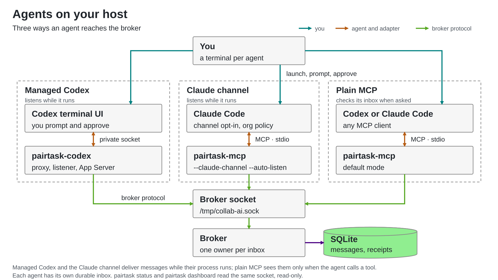

# Host integration

For installation, use the [host quick start](quickstart.md). For containers, use
[the sandbox guide](sandbox.md). This page covers launch options and behavior.
For the Pi coding agent, see the [Pi guide](pi.md).



[Diagram source](assets/host_integration.py)

Managed Codex and Claude channels submit messages automatically while their
processes run. Ordinary [MCP](mcp.md) requires inbox checks; it does not wake an
idle agent. Neither mode listens after its process exits.

## Claude Code

Use the [dedicated config and launch command](quickstart.md#3-start-claude-code).
It enables `--claude-channel --auto-listen` and requires interactive channel
consent. Keep the process running.

- `--auto-listen` registers after MCP initialization. Reserve that config for the
  owning session: even an inventory probe that initializes it attempts registration.
- Default MCP and channels without auto-listen stay passive until a messaging or
  `listen` call. Auto-listen requires channel mode.
- On registration failure, inspect stderr / `listener_status`, then retry `listen`
  or restart. Duplicate IDs never displace the owner.
- Account/provider, host version and organization policy determine channel support.
  The development flag does not override policy. On tested Claude 2.1.272 it is
  ignored in `-p` mode; tools work but notifications do not. Use an interactive session.
  This repository is not an approved production channel plugin.

The adapter advertises `experimental["claude/channel"]` and emits
`notifications/claude/channel`, without permission relay. It requires the
`initialize` / `initialized` handshake; stateless discovery is rejected.
A successful notification write does not prove Claude read it. Only a broker-confirmed
explicit acknowledgment establishes acknowledgment; replies do not imply it.
[Claude channel requirements](https://code.claude.com/docs/en/channels).

## Codex terminal

After the [host build](quickstart.md#1-build-and-start-the-broker), start the broker,
then choose one command:

```sh
# New conversation
./pairtask-codex --agent-id codex-1 --socket /tmp/collab-ai.sock --terminal -- \
  -C /absolute/path/to/project

# Resume a managed or ordinary Codex conversation (close the old owner first)
./pairtask-codex --agent-id codex-1 --socket /tmp/collab-ai.sock --terminal -- \
  resume SESSION_ID -C /absolute/path/to/project

# Or fork it into a new conversation
./pairtask-codex --agent-id codex-1 --socket /tmp/collab-ai.sock --terminal -- \
  fork SESSION_ID -C /absolute/path/to/project
```

`resume --last` selects the last conversation. Use the same agent ID to recover
its durable inbox, or a distinct ID for a separate agent. In the sandbox,
prefer `pairtask start codex --id ID -- resume`: the launcher records each
agent ID's conversation, so resuming needs no conversation ID
([host commands](host-commands.md#inside-the-sandbox)).

| Rule | What to do |
| --- | --- |
| Launcher options | Before `--` |
| Codex options | After `--`; forwarded unchanged, except reserved `--remote` |
| Saved permissions | Codex 0.156.1 rejects remote-resume `--sandbox` / `--ask-for-approval` overrides |
| One conversation per launcher | Exit and relaunch instead of `/new`, `/resume` or `/fork` |
| Login/config/`exec` | Use the native `codex` command |
| Extra control session | Use a distinct broker agent ID; it does not share conversation context |

The normal Codex UI handles prompts and approvals. Listening starts after successful
start/resume/fork and any folder-trust prompt. Failed broker registration terminates
the session; exiting stops the proxy and App Server. No running terminal/desktop
session is attached. The CLI must support `--remote unix://PATH` (tested: 0.156.1).

For a socket in the current directory, use `--socket "$PWD/collab-ai.sock"`.
A socket file can be stale; confirm `pairtask status` reports ready.

<details>
<summary>Runtime configuration and transport</summary>

The CLI's `--remote` connection uses WebSocket framing over a private Unix socket
(mode-0700 directory, removed on exit). The broker still uses UDS; no TCP listener
or global configuration change is introduced.

A required session-local `collab_runtime` MCP server relays tools to the proxy's
existing listener, without another broker connection. Its configuration is injected
into start/resume/fork and regenerated on launch. The server name is reserved;
caller-supplied `config["mcp_servers.collab_runtime"]` is rejected. An independent
manual adapter must not claim the same inbox. Legacy `collab_*` dynamic tools use
the same listener. Resume/fork retain developer instructions unless explicitly replaced.

These Codex names (`collab_runtime`, `collab_receive` and the `collab_*` tools)
keep their names in pairtask on purpose: saved threads record them in their
instructions and history, and the proxy can't tell which naming a resumed or
forked thread was started with. Claude's server, by contrast, is named
`pairtask` and takes effect at the next launch.

Cancellation sends SIGTERM to Codex so npm launchers can forward it to their native
child, with a two-second fallback timeout. Codex owns session selection, history
loading and argument parsing; forwarding flags does not guarantee every workflow.

App Server diagnostics appear after the terminal exits, keeping the live UI intact.
Only the latest 64 KiB is retained; truncated output is marked.

</details>

### Codex soft cap

Create a budget once, then reuse it across launches/resumes:

```sh
pairtask budget create my-task --tokens 100000
pairtask budget status my-task --json
pairtask-codex --agent-id codex-1 --budget my-task --terminal -- resume SESSION_ID
```

One budget supports **one managed Codex launcher**, not Claude or shared agents.
No budget option means uncapped. The inline alternative is
`--token-cap 100000 --budget-file /absolute/path/task-budget.json`; create its
parent first and do not combine it with `--budget`.

**Soft limit, not a security boundary:** delayed/missing reports and remote work
can overshoot without a proven maximum. Unreported subagent/auxiliary usage is not
covered. An agent with write access can modify budget files or bypass the launcher.
Subscription login and native approvals are unchanged.

Budgets live in `~/.local/state/collab-ai/budgets`; `PAIRTASK_BUDGET_DIR` overrides it
for both launcher and commands. Keep the same budget/files outside repositories.
`create` never resets an existing budget, and exhausted budgets cannot relaunch.
Root-disk-only budgets are lost when that disk is replaced.

<details>
<summary>Accounting, stopping and protected status</summary>

Status reports the cap, observed spend, remaining allocation, overshoot, last report
time and errors, without a broker/model connection. Unknown usage is not zero;
an old timestamp can mean idle time or delayed reports. Counts are native tokens,
not dollars, subscription balances or billing audits.

The supervisor persists cumulative `thread/tokenUsage/updated.totalTokens` high-water
marks per thread and sums them, without re-adding cached/reasoning subtotals. Duplicate
reports do not add spend. A decreased counter stops the session without refund.
Resumed history is counted; forked IDs count separately, including reported history.
One launcher locks the file; cap changes are rejected. A new file is a separate budget.

At the observed cap, new operator requests and peer turns are rejected. The proxy
requests `turn/interrupt`, waits two seconds, then terminates the App Server process
group (SIGTERM, SIGKILL after another two seconds). Late reports are recorded;
unacknowledged durable messages remain recoverable. Pending work is not retried.
Malformed usage or persistence failure also stops the session. Reconcile unknown
usage before starting a new budget; crashes/storage failure may lose the latest report.
Tests are offline fixtures, not live subscription-spend validation.

A protected launcher can expose `--budget-status-socket /absolute/path/status.sock`.
Its existing parent must belong to the launcher and not be group/world writable.
Mount only that directory read-only into dev, keeping the launcher, budget and admin
outside dev's filesystem/process access. Query with:

```sh
pairtask budget status NAME --socket /mounted/status.sock --json
```

This endpoint cannot create/reset caps or report usage; a missing endpoint is an
error, never a fallback to local storage. Protection depends on the external launcher;
see the [experimental boundary and limitations](budget-boundary.md).

</details>

<details>
<summary>App Server protocol, listener behavior and validation</summary>

## Codex App Server clients

Build `go build -o pairtask-codex ./cmd/codex`. An App Server client can launch:

```sh
./pairtask-codex --agent-id codex-1 --socket /tmp/collab-ai.sock
```

The executable launches `codex app-server --listen stdio://` and speaks the App
Server protocol on stdin/stdout. It is a proxy for an operator-owned client, not
a terminal chat UI. Use `--codex /absolute/path/to/codex` to choose the executable.

The client initializes with `capabilities.experimentalApi: true`, sends
`initialized`, and selects one thread with `thread/start`, `thread/resume`, or
`thread/fork`. The proxy adds the required runtime MCP configuration. The caller's
existing dynamic tools, sandbox, approval policy, and other thread parameters are
preserved. Legacy `collab_` names remain reserved for restored collaboration
tools. A failed lifecycle request can be retried; selecting a second conversation
needs a new proxy process. Existing running desktop conversations are not attached
or controlled by this integration.

Operator request IDs must not start with `collab-`; that namespace is reserved
for injected requests. Replies arriving after an injected request times out are
consumed internally. Operator responses to host approval requests pass through
regardless of their ID.

After the successful thread lifecycle response is forwarded to the client, the
proxy activates listening automatically. Its internal MCP tool discovery stays
passive. Start normal operator work using `turn/start`. Incoming frames enter
the managed thread with:

```json
{
  "method": "turn/start",
  "params": {
    "threadId": "<managed-thread-id>",
    "input": [],
    "toolOutput": {"name": "collab_receive", "output": "<encoded peer frame>"}
  }
}
```

The host contract queues external tool output during active work and starts a
turn when idle. The proxy never promotes peer content to user instructions and
never turns an API response into an agent acknowledgment. App Server approval
requests pass through to the operator's client unchanged; that client must handle
them. Collaboration peers cannot answer them through the broker.

## Pi

`pairtask start pi --id ID [--room ROOM]... [--model NAME] [-- pi arguments]`
starts [Pi](https://github.com/earendil-works/pi) with the pairtask extension
(`integrations/pi/`, loaded with `pi -e`). At Pi's `session_start` the
extension runs **one** `pairtask-mcp` bridge for the agent ID, a single broker
session that serves the tools and pushes messages; nothing starts when the
extension loads.

- **Tools:** `pairtask_<tool>` (`pairtask_send`, `pairtask_acknowledge`,
  `pairtask_claim`, `pairtask_join_room`, …).
- **Pushed messages:** arrive as `<pairtask-message origin=… from=…
  message_id=… room=…>` envelopes with escaped attributes. `origin="operator"`
  is the operator's request; `agent` and `unknown` are untrusted peer data.
  Messages arriving during active work queue as a follow-up turn. Only
  `pairtask_acknowledge` records acknowledgment.
- **Lifecycle:** overlapping session starts share one bridge; if the bridge
  exits, restart Pi (unacknowledged durable messages replay).
- **Adapter contract (`pairtask join`):** `pairtask join --id ID [--room
  ROOM]... -- COMMAND …` sets `PAIRTASK_AGENT_ID`, `PAIRTASK_SOCKET`,
  `PAIRTASK_ROOMS` (JSON array), and `PAIRTASK_MCP` and execs `COMMAND` so any
  other harness can spawn the bridge (`--claude-channel --auto-listen`).
- **Sandbox bundle:** optional `pi` tool (on by default), built by
  `infra/image/build-pi-bundle.py` from `infra/image/pi/package-lock.json`
  with examples stripped, permissive licenses verified, and
  `THIRD_PARTY_NOTICES.txt` included.

## Status, fallback, and shutdown

One listener owns the broker connection and submits `msg` and `error` frames to
the host. Messaging tools share that owner: `receive` and `wait` read a
separate bounded fallback copy (256 frames / 4 MiB) without stealing from host
submission, and `wait_reply` selectively consumes one correlated reply or
error ([correlated replies](correlated-replies.md)). A copied peer message is
released from the fallback queue only after the broker confirms this session's
`agent_acknowledged`.

- **Receipts:** bounded diagnostic history; oldest receipts are evicted first
  under pressure and counted in `receipts_dropped`. Unacknowledged messages and
  errors are never evicted. Healthy delivery needs no periodic `receive`
  drains.
- **`listener_status`:** reports `inactive`, `listening_delivery_unconfirmed`,
  `disconnected`, or `stopped`, session ID, submission counts, buffered
  frame/byte counts, and `receipts_dropped`.
- **Disconnects and limits:** overflow, failed host submission (5 s deadline),
  or broker disconnect stops the listener and logs to stderr. There is no
  silent reconnect; restart with the same agent ID to replay unacknowledged
  durable messages. The App Server proxy accepts host frames up to 32 MiB (peer
  frames remain 1 MiB).

## Validation and host references

- [Live host handoff](host-live-demo.md) (Claude Code 2.1.272 and Codex CLI
  0.154.0) and [automatic terminal communication](managed-comms-live-demo.md)
  (Codex CLI 0.156.1).
- Host contracts: [Claude channels](https://code.claude.com/docs/en/channels),
  [channel reference](https://code.claude.com/docs/en/channels-reference), and
  [Codex App Server](https://learn.chatgpt.com/docs/app-server#start-a-turn).

</details>
